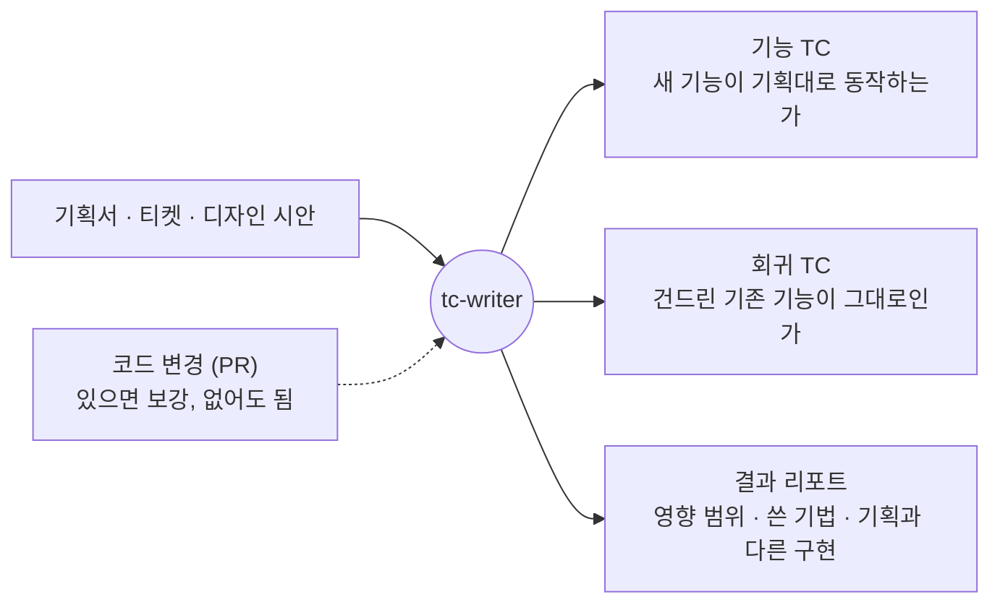

# tc-writer

> Feature QA의 테스트케이스를 쓰는 Claude Code 스킬. 작성 시간 2시간 → 6분 (95% 감소)

| | |
|---|---|
| **역할** | 설계, 구현, 고도화. 팀 스킬 저장소에 올려 QA 동료도 사용 |
| **기간** | 2026.04 ~ 현재 |
| **목표** | QA가 TC를 쓸 때 지키는 판단 기준을 AI가 그대로 따르게 하고, 줄어든 시간을 제품을 더 들여다보는 데 쓴다 |
| **기술** | Claude Code Skill, Python(openpyxl), HTML |

| **95%** | **+10 ~ +14%p** | **36건** |
|:---:|:---:|:---:|
| TC 작성 시간 감소<br>(2시간 → 6분) | 엣지 체크리스트의 커버리지 효과<br>(블라인드 A/B 테스트) | 4~9월 실무 사용<br>(QA 동료 사용분 포함) |

사람 기록에는 무엇을 테스트할지 고르는 시간이 빠져 있어 실제 업무 시간은 이보다 길다. 커버리지는 6월에 한 번 잰 파일럿 결과다. 전문 용어는 [용어 메모](#용어-메모)에 모았다.

## 1. 왜 만들었나

Feature QA는 새 기능이 배포되기 전에 그 기능을 검증하는 QA다. 요구사항을 분석하고 테스트 전략을 세운 뒤 TC를 쓰는데, TC는 기능마다 새로 써야 해서 사람이 하면 기능 하나에 2시간 안팎이 걸렸다.

AI가 쓴 TC를 그대로 쓰려면 QA가 TC를 쓸 때 지키는 판단 기준을 AI도 지켜야 한다. 그 기준을 스킬 구조로 고정하고, 실무에서 문제가 생길 때마다 고도화했다.



필수 입력은 기획서뿐이라 구현 전에도 TC를 만들 수 있다. 제품 전체를 다시 훑는 정기 회귀 테스트는 이 스킬이 다루지 않는다.

## 2. 내가 한 일

| 단계 | 한 일 | 결과물 |
|---|---|---|
| 설계 | QA의 판단 기준 3가지를 정하고, 지키게 하는 방법을 규칙과 스크립트 검사로 나눴다 | 세 부분 구조, 작업 9단계 |
| 구현 | 작성 규칙, 참고 문서 10개, 엑셀 생성·검토 모드·부분 수정 스크립트를 만들었다 | `SKILL.md`, `references/`, `scripts/` |
| 검증 | 버전 4개를 같은 기획서로 비교해 무엇이 효과 있는지 가렸다 | 블라인드 A/B 테스트 결과 |
| 고도화 | 실무에서 받은 지적을 사고 기록으로 남기고 규칙이나 검사로 바꿨다 | 사고 기록 17건 |
| 배포 | 팀 스킬 저장소에 올려 QA 동료가 쓸 수 있게 했다 | 4~9월 TC 파일 36건 |

## 3. 구조

판단 기준마다 스킬이 지키게 하는 방법이 있다. 확인할 수 있는 기준은 지시문이 아니라 스크립트가 검사한다.

| QA의 판단 기준 | 스킬이 지키게 하는 방법 |
|---|---|
| 기대결과는 기획서에서 가져온다 | 코드는 영향 범위를 찾는 데만 쓴다. 기획과 다르게 구현된 부분은 TC 기대결과에 섞지 않고 버그 후보로 따로 적는다 |
| 회귀는 이번 변경이 영향을 주는 곳에서 뽑는다 | 영향받는 기존 기능마다 회귀 TC가 있는지 스크립트가 검사하고, 빠지면 엑셀을 만들지 않는다 |
| 놓치기 쉬운 케이스를 점검한다 | 엣지 7패턴 판정 기록이 없으면 엑셀을 만들지 않는다 |

스킬은 본문, 참고 문서, 스크립트 세 부분이다. 순서와 규칙은 본문에, 상세 지식은 참고 문서에 두고, 지켜졌는지는 스크립트가 본다. 참고 문서는 해당 단계에 도착했을 때만 읽는다.

```
tc-writer/
├── SKILL.md                     # 작업 순서 9단계, 작성 규칙
├── references/                  # 단계별로 필요할 때만 읽는 참고 문서 10개
│   ├── impact-analysis.md       #   영향 범위 분석법
│   ├── techniques.md            #   테스트 기법
│   ├── edge-case-checklist.md   #   엣지 7패턴
│   ├── quality-principles.md    #   작성 품질 원칙
│   ├── incident-log.md          #   사고 기록 17건
│   └── …                        #   섹션 설계법, 출력 명세, 리포트 양식 등
└── scripts/
    ├── build_plan.py            # 검토 모드: 설계맵 생성 + 검사
    ├── build_excel.py           # 엑셀 생성 + 검사
    └── patch_excel.py           # 부분 수정 (미리보기 후 반영)
```

작업 순서는 사람이 TC를 쓸 때 거치는 순서를 그대로 옮겼다. 모르는 것 확인, 요구사항 정리, 기획과 구현 비교, 영향 범위, 테스트 기법, 목차와 엣지 점검, 본문 작성, 엑셀 생성, 결과 리포트까지 9단계다. 근거와 상세는 [설계 노트](docs/design-notes.md)에 있다.

## 4. 고도화 이력

처음에는 TC를 제대로 만드는 것이 문제였고, 그게 풀리자 사람이 검토하고 수행하기 쉬운 TC가 문제가 됐다.

| 시기 | 문제 | 조치 | 결과 |
|---|---|---|---|
| 4~5월 | TC 형식이 실행마다 다르고 코드 용어가 섞였다 | 내용(JSON)과 형식(스크립트)을 분리했다 | 실행마다 같은 10개 컬럼 엑셀 |
| 6월 | 개선이 효과가 있는지 몰랐다 | 버전 4개를 블라인드 A/B 테스트했다 (기준 TC 2모음 × 3회) | 구조 정리 **−2.2 ~ −6.2%p**, 엣지 체크리스트 **+10.0 ~ +14.0%p** |
| 7월 | 체크리스트를 읽지 않은 실행 4회, TC가 정상 흐름 위주로 얇아졌다 | 7패턴 판정을 스크립트가 검사한다 (게이트) | 모든 엑셀의 요약 시트에 패턴별 판정이 남는다 |
| 7~8월 | 완성된 TC를 검토하기 어렵고 누락이 많았다. 변경 크기에 비해 63건이 나온 사례도 있었다 | 목차를 먼저 검토하는 모드와 HTML 설계맵을 만들었다 | 같은 사례가 **34건**으로 줄었다 |
| 8~9월 | 파일을 통째로 다시 만들어 QA가 입력한 결과가 사라졌다 (6월 사례: PC 57건, 모바일 25건) | 덮어쓰기를 막고, 미리보기 후 반영하는 부분 수정 도구를 만들었다 | 결과 칸은 스크립트가 고칠 수 없다 |
| 9월 | 설계맵 첫 화면이 17,267자였고 섹션 8개가 모두 펼쳐져 있었다 | 첫 화면을 4개 요소로 줄이고 나머지는 접었다 | 2,844자 (**84% 감소**), 숨어 있던 빈 요구사항 2개 발견 |

**6월이 전환점이었다.** 구조만 정리한 버전은 정리 전보다 커버리지가 낮았고 TC도 덜 만들었다(36건 → 27건, 31건 → 24건). TC 품질을 올린 것은 파일 정리가 아니라 QA 지식(엣지 체크리스트)이었다. 그래서 7월 이후에는 그 지식을 AI가 빠뜨리지 않게 지키게 하는 일에 집중했다.

이후의 변경은 같은 방식으로 했다. 지적이 나오면 사고 기록에 증상, 원인, 대응을 남기고, 코드로 지켰는지 확인할 수 있으면 스크립트 검사로, 아니면 작성 규칙으로 바꿨다.

## 5. 결과

| | 이전 | 이후 |
|---|---|---|
| TC 작성 시간 (같은 기획서 1건) | 사람 2시간 0분 | 스킬 6분 (95% 감소) |
| 엣지 체크리스트 효과 (커버리지) | | +10.0 ~ +14.0%p |
| 검토용 설계맵 첫 화면 | 17,267자 | 2,844자 (84% 감소) |
| 실무 사용 | 3월 0건 | 4~9월 TC 파일 36건 |

줄어든 시간은 앞 단계에 썼다. QA의 흐름은 요구사항 분석과 PRD 리뷰, 테스트 전략, TC 작성 순서로 그대로이고, 앞의 두 단계에도 AI 에이전트를 함께 쓴다. TC 작성이 짧아진 만큼 앞 단계를 더 오래 보면서 사용자가 이 흐름에서 어디가 불편할지 찾는 데 시간을 쓴다.

## 6. 배운 점

| 배운 점 | 근거 |
|---|---|
| **깔끔해 보이는 것과 나아진 것은 재 봐야 구분된다** | 6월에 구조를 정리하자 파일은 보기 좋아졌지만 커버리지는 내려갔다 |
| **꼭 필요한 단계는 지시하지 말고 검사한다. 막아 주는 것이 없는 값은 조용히 사라진다** | 체크리스트를 읽으라는 지시는 4번 무시됐고, 검사로 바꾸자 빠지지 않았다. 값을 잘못 읽은 때도 검사가 걸린 항목은 바로 멈췄고 검사가 없던 항목은 조용히 비었다 |
| **엣지 케이스는 전부 채우지 말고 조건에 맞는 것만 판다** | 모든 기능에 다 대입하면 테스트 기법과 겹치고 읽기 전용 화면에는 소용없는 케이스가 쌓였다. 패턴마다 적용 조건을 붙였다 |
| **TC 번호는 순서가 아니라 이름표다** | 수행 결과와 버그 티켓이 번호를 가리킨다. 번호를 다시 매기거나 끼워 넣으며 밀면 근거가 다른 케이스를 가리킨다. 번호는 고정하고 중간 추가는 소수점으로 한다 |
| **AI 결과물은 사람이 검토하기 쉬워야 쓸 수 있다** | 7월 이후 변경의 대부분은 TC를 더 잘 만드는 일이 아니라 검토와 수행을 쉽게 만드는 일이었다 |

## 7. 다음 단계

| 항목 | 이유 |
|---|---|
| 이 스킬이 만든 TC를 입력으로 자동 테스트 코드(E2E)를 만드는 스킬 | 사람이 수행하는 시간을 더 줄이기 위해. 이어서 개발 중 |
| 부분 수정 도구에 중간 행 삽입 기능 | 지금은 중간에 TC를 끼워 넣을 수 없다 |

## 더 읽기

- [설계 노트](docs/design-notes.md): 판단 기준을 지키게 하는 방법, 참고 문서를 읽는 단계, 6월 실험 상세, 사고 기록, 주요 결정과 이유

## 용어 메모

<details>
<summary>펼쳐서 보기</summary>

| 용어 | 뜻 |
|---|---|
| Feature QA | 새 기능이 배포되기 전에 그 기능을 검증하는 QA |
| TC (테스트케이스) | 사전조건, 절차, 기대결과로 이뤄진 점검 항목 하나 |
| 기대결과 | 기능이 정상이라면 보여야 하는 결과 |
| PRD | 기능이 무엇을 해야 하는지 적은 기획서 |
| 회귀 (Regression) | 이번 변경 때문에 기존 기능이 깨지는 것 |
| 영향 범위 분석 | 이번 변경이 어디에 영향을 주는지 찾아 테스트 범위를 정하는 일 |
| 엣지 7패턴 | 놓치기 쉬운 케이스를 7가지 유형으로 모은 목록. 유형마다 적용 조건이 있다 |
| 게이트 | 정해진 조건을 만족하지 않으면 다음 단계로 못 넘어가게 막는 검사 |
| 검토 모드 | TC 목차까지만 만들고 멈춰서 사람이 검토한 뒤 본문을 쓰게 하는 실행 방식 |
| 설계맵 | 검토 모드가 만드는 HTML 문서. 바뀐 것과 먼저 볼 것을 첫 화면에 보여 준다 |
| 블라인드 A/B 테스트 | 채점할 때 어느 버전의 결과인지 모르게 하고 버전들을 비교하는 방법 |
| 커버리지 | 기준 TC 중 같은 내용을 스킬이 만들어 낸 비율 |
| %p (퍼센트포인트) | 비율끼리의 차이. 50%에서 60%가 되면 10%p |
| 파일럿 | 규모가 작아 결론보다 방향을 보는 시험적인 측정 |

</details>
