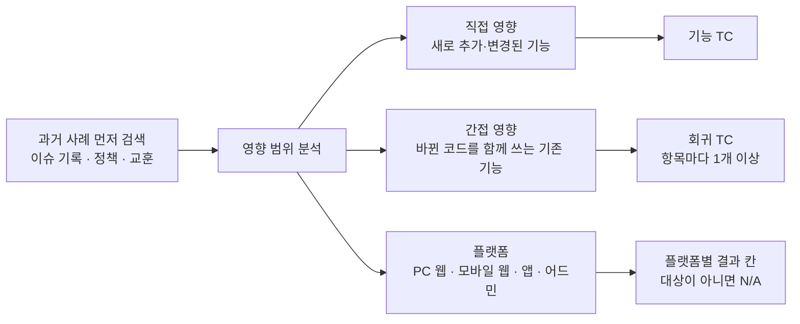
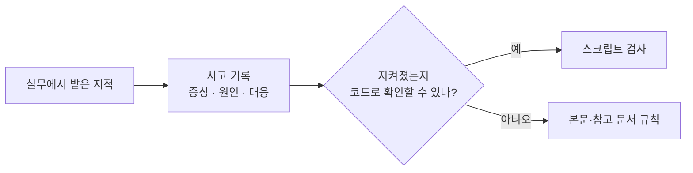

# tc-writer 설계 노트

[README](../README.md)를 읽고 구조와 근거가 더 궁금한 사람을 위한 글이다. 각 장은 질문 하나에 답하는 형식으로 썼다.

## 1. 지켰는지 어떻게 아나

README의 판단 기준 3가지마다 규칙이 있고, 확인할 수 있는 건 스크립트가 검사한다.

| 판단 기준 | 규칙 | 스크립트 검사 |
|---|---|---|
| 기대결과는 기획서에서 | 코드는 영향 범위를 찾는 데만 쓰고, 기획과 다른 구현은 버그 후보로 따로 적는다. PR은 선택 입력이다 | 검토 모드에서 TC마다 근거(기획 문서, 코드, 추론)를 적는다. 기획 문서나 코드가 근거인데 위치가 없으면 멈춘다 |
| 회귀는 영향 범위에서 | 영향받는 기존 기능마다 회귀 TC를 1개 이상 둔다 | 항목마다 회귀 TC가 없으면 멈춘다. 회귀가 전체의 30% 미만이면 경고한다 |
| 엣지는 7패턴으로 | 조건이 맞는 패턴만 적용한다 | 판정이 없거나, "적용"인데 연결된 TC가 없으면 멈춘다 |

가상의 "게시글 작성" 기능으로 보면 이렇다.

1. AI가 TC를 쓰면서 회귀를 확인해야 할 화면 목록도 함께 적는다. 예를 들어 마이페이지 목록과 검색 결과 목록이다.
2. 그런데 "검색 결과 목록"을 확인하는 TC는 만들지 않았다.
3. 스크립트가 이를 찾아 엑셀을 만들지 않고, "검색 결과 목록을 확인하는 TC가 없다"고 알려 준다.

사람이 찾기 전에 스킬이 먼저 빠진 곳을 잡는다. 엣지 판정도 같은 방식으로 검사한다. 회귀 TC 개수를 비율로 정하지 않은 이유는 5장에 있다.

## 2. 영향 범위는 어떻게 TC가 되나

간접 영향은 문서를 믿지 않고, 바뀐 컴포넌트와 API가 어디서 쓰이는지 코드에서 직접 검색해 나열한다.

## 3. 엣지 7패턴은 언제 적용하나

조건이 맞을 때만 적용한다. 전부 적용하면 쓸모없는 케이스가 늘어서 조건부로 고쳤다.

| 패턴 | 적용 조건 |
|---|---|
| 권한·인증 경계 | 접근 권한이 있는 화면·동작 |
| 비정상 입력 | 사용자 입력값을 저장하거나 보여 주는 기능 |
| 상태 유지 | 입력, 정렬, 필터, 임시저장 상태가 있는 화면 |
| 중복 실행 (멱등성) | 삭제, 제출, 결제처럼 두 번 실행되면 문제가 되는 동작 |
| 여러 화면이 함께 쓰는 자원 | 공통 컴포넌트, 판정 로직, 설정을 바꿀 때 |
| 표시 가공 | 저장한 값을 그대로 보여 주지 않을 때 |
| 테스트 데이터 준비 | 특정 상태의 데이터가 있어야 확인할 수 있을 때 |

## 4. 참고 문서는 언제 읽나

읽을지 말지는 AI가 판단하지 않는다. 문서마다 읽는 단계를 정해 두고, 그 단계에 도착했을 때만 읽는다. 처음부터 끝까지 실행하면 모두 한 번씩 읽힌다. 줄어드는 것은 시작할 때 전부 읽어야 하는 부담이다.

| 단계 | 읽는 참고 문서 | 남기는 것 |
|---|---|---|
| 0~2. 확인, 요구사항 정리, 기획과 구현 비교 | 없음 | 질문, 규칙 목록, 기획과 다른 구현 |
| 3. 영향 범위 | 영향 범위 분석법 | 직접·간접 영향 목록 |
| 4. 테스트 기법 | 테스트 기법 | 기법과 선택 이유 |
| 5. 목차, 엣지 점검 | 섹션 설계법, 엣지 체크리스트 | 목차, 패턴별 판정 |
| 6. 본문 작성 | 품질 원칙 | TC 데이터(JSON) |
| 7~8. 엑셀, 리포트 | 출력 명세, 리포트 양식 | 엑셀, 리포트 |

규칙으로 정해 둔 예외는 이렇다.

| 경우 | 읽지 않는 문서 | 이유 |
|---|---|---|
| 검토 모드의 계획 파일이 이미 있다 | 분석용 4개(영향 범위, 기법, 섹션 설계, 엣지) | 분석 결과가 계획 파일에 들어 있다 |
| TC를 만드는 중이다 | 엑셀 서식 명세 | 서식은 스크립트가 갖고 있다. 스크립트를 고칠 때만 읽는다 |
| 평소 실행 | 사고 기록 | 규칙을 고치거나 예외를 두려 할 때만 읽는다 |
| 기본 모드 | 계획 파일 명세 | 검토 모드에서만 쓴다 |

읽었는지는 이렇게 확인한다. 엣지 체크리스트는 엑셀 생성 스크립트를 실행하기 전에 이 세션에서 실제로 열었는지 본다. 안 열었으면 실행을 막고, 열었더라도 7패턴 판정 기록이 없으면 엑셀을 만들지 않는다. 나머지 문서는 읽었는지를 직접 확인하지 않고 결과물을 검사한다. 영향 범위 분석을 건너뛰면 회귀 TC가 빠진 결과로 드러나 스크립트에 걸린다.

참고 문서의 근거는 다음과 같다.

| 규칙 | 근거 |
|---|---|
| 테스트 기법 선택표 | ISO/IEC/IEEE 29119의 기법 정의(언제 쓰나, 절차) |
| 우선순위 P0~P3 | 29119의 위험 기반 테스팅(발생 가능성 × 영향도) |
| TC 10개 컬럼 | 29119의 테스트케이스 명세 구성(입력, 사전조건, 기대결과) |
| 엣지 체크리스트 | 실무 경험으로 만든 목록. 7월 실험 결과로 조건부 적용으로 고쳤다 |
| 작성 규칙, 품질 원칙 | 실무에서 받은 지적 17건(6장 사고 기록) |
| 세 부분 구조 | Claude 스킬 공식 작성 가이드 |

## 5. 6월 실험은 어떻게 했나

버전 4개를 만들고 사람이 손으로 쓴 기준 TC 두 모음과 비교했다. 같은 내용을 스킬이 얼마나 만들었는지를 커버리지로 보고, 모음마다 3번씩 채점했다. 채점할 때는 어느 버전인지 모르게 했다.

| 변경 | 기준 TC 1 (89건) | 기준 TC 2 (35건) | 평균 |
|---|---|---|---|
| 체크리스트 추가 (정리 전 버전에) | 0 | +20.0%p | +10.0%p |
| 체크리스트 추가 (정리 후 버전에) | +7.1%p | +20.9%p | +14.0%p |
| 구조 정리 (체크리스트 없이) | −8.6%p | −3.8%p | −6.2%p |
| 구조 정리 (체크리스트 있는 상태에서) | −1.5%p | −2.9%p | −2.2%p |

기준 TC가 두 모음뿐이고 모음마다 결과 차이가 커서 파일럿으로 본다. 구조를 정리한 버전은 TC도 덜 만들었다(36건 → 27건, 31건 → 24건).

## 6. 지적은 어떻게 규칙이 되나

실무에서 지적을 받으면 사고 기록에 남기고, 규칙이나 검사로 바꾼다. 지금까지 17건이다.

| 사고 | 어디로 갔나 | 바뀐 것 |
|---|---|---|
| AI가 엣지 체크리스트를 읽지 않고 넘어갔다(4회) | 검사 | 7패턴 판정이 없으면 스크립트가 멈춘다 |
| 파일을 새로 만들어 덮어쓰자 QA가 입력한 결과가 사라졌다 | 검사 | 같은 위치에 파일이 있으면 스크립트가 멈춘다 |
| 사전조건에 "TC-001과 동일"처럼 다른 TC를 가리켰다 | 규칙 | 한 행만 보고 준비할 수 있게 쓴다 |
| 모든 사전조건에 같은 테스트 환경을 적어 진짜 준비물이 안 보였다 | 규칙 | 기본에서 벗어나는 조건만 쓴다 |
| 알림을 보낸 순간의 상태로만 설계했다 | 규칙 | 상태 유지 패턴에 "받은 것이 남아 있는 기능" 기준을 추가했다 |

## 7. 단계별 상세

README의 고도화 이력에 없는 내용만 모았다.

| 단계 | 상세 |
|---|---|
| 4~5월 형식 고정 | 컬럼 10개(TC 번호, 우선순위, 영역, 목적, 사전조건, 절차, 기대결과, PC 결과, 모바일 결과, 비고). 섹션은 사용자 시나리오별로 묶고, TC 하나에 검증 하나만 둔다 |
| 7월 스크립트 검사 | 엣지 판정 검사가 처음이었고, 기본 모드의 회귀 검사는 10월에 추가했다 |
| 7~8월 검토 모드 | TC마다 본문 없이 번호, 우선순위, 목적, 연결된 요구사항, 근거, 판정 방법(화면, 네트워크, 로그, 데이터베이스)만 정한다 |
| 8~9월 결과 보존 | 쓰기 직전에 파일 수정 시각을 다시 확인한다. 무효가 된 TC는 지우지 않고 비고에 표시한다 |

## 8. 결정과 이유

| 질문 | 선택 | 이유 |
|---|---|---|
| 엑셀 서식을 누가 만드나 | 고정된 스크립트 | AI가 매번 서식을 그리면 드롭다운, 색 같은 서식이 빠졌다 |
| 회귀 TC를 얼마나 만드나 | 영향받는 기존 기능마다 1개 이상 | 비율로 채우면 영향받지 않은 기능이 섞이거나 영향받은 기능이 빠진다 |
| 엣지 체크리스트를 전부 적용하나 | 조건이 맞는 패턴만 | 전부 적용하면 쓸모없는 케이스가 늘었다 |
| 꼭 지킬 규칙을 어떻게 지키게 하나 | 스크립트 검사 | 지시문은 지켰는지 확인할 수 없었다 |
| 확신도를 점수로 매기나 | 근거만 적고 상·중·하로 표시 | AI가 자기 결과에 점수를 매기지 않게 하고, 검토자가 근거가 약한 TC부터 보게 하려고 |
| 목차 검토를 별도 도구로 두나 | 같은 스킬의 모드 | 계획 파일을 본문 작성이 그대로 읽어서 분석을 반복하지 않는다 |
| 쓰고 있는 파일을 고칠 때 | 부분 수정(중간 행 삽입은 아직 없음) | 수행 결과를 보존한다 |
